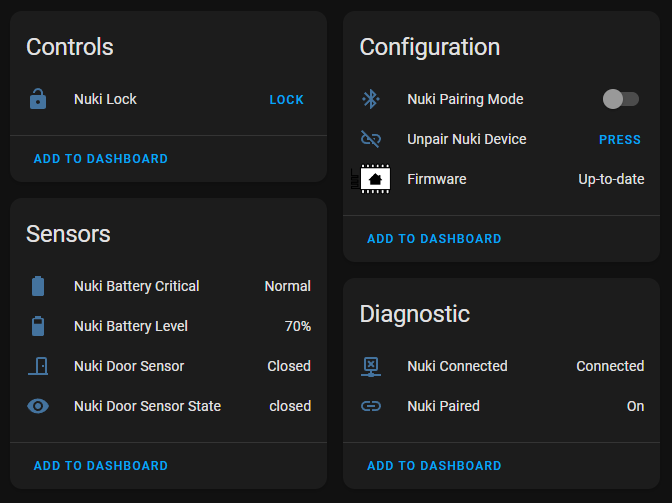

# ESPHome Nuki Lock Component (ESP32) [](https://github.com/uriyacovy/ESPHome_nuki_lock/actions/workflows/build.yaml)

Turn an ESP32 into a local Bluetooth bridge for Nuki Smart Locks (1st–5th Gen, Ultra, Go, Pro) and get a full-featured lock in Home Assistant via ESPHome, with [many entities](#-entities) for state, battery and lock settings. No cloud and no official Nuki Bridge needed.



**Highlights**

- Lock, unlock, unlatch and Lock 'n' Go from Home Assistant or ESPHome automations
- Instant state updates when paired as bridge, or via the lock's own MQTT in [hybrid mode](#-hybrid-mode-official-mqtt--ble)
- Battery, door sensor and connectivity sensors, plus most lock settings as switches, selects and numbers
- [Keypad management](#-home-assistant-actions), [event logs](#-event-logs) and [door sensor emulation](#-door-sensor-emulation)
- Uses ESPHome's own BLE stack, so it runs next to `bluetooth_proxy` and other BLE components

## Contents

- [Requirements](#-requirements)
- [Quick Start](#-quick-start)
- [Pairing](#-pairing)
- [Configuration Options](#%EF%B8%8F-configuration-options)
- [Door Sensor Emulation](#-door-sensor-emulation)
- [Hybrid Mode (Official MQTT + BLE)](#-hybrid-mode-official-mqtt--ble)
- [Event Logs](#-event-logs)
- [Home Assistant Actions](#-home-assistant-actions)
- [ESPHome Automations](#-esphome-automations)
- [Entities](#-entities)
- [Troubleshooting](#%EF%B8%8F-troubleshooting)
- [Tested Hardware](#-tested-hardware)
- [Credits](#-credits)

---

# 📋 Requirements

| Requirement | Details |
| ----------- | ------- |
| ESP32 | Any ESP32 with Bluetooth LE (tested: ESP32, ESP32-S3, ESP32-C3). ESP8266 and RP2040 are not supported. |
| ESPHome | **2026.10.0 or newer** |
| Framework | `esp-idf` (recommended) or `arduino` |
| Placement | Within reliable Bluetooth range of the lock, check the `bt_signal_strength` sensor |

Good to know before you start:

- **BLE stack:** The component uses ESPHome's native BLE stack (`esp32_ble_tracker` / `esp32_ble_client`), which is added automatically. It coexists with `bluetooth_proxy`, `esp32_improv` and other BLE components.
- **Connection slots:** Each `nuki_lock` uses one of the ESP32's BLE connection slots (`esp32_ble: max_connections`, default 3). If you also run `bluetooth_proxy`, make sure enough slots are left.
- **Scan parameters:** The component sets `esp32_ble_tracker` to continuous active scanning (`interval: 40ms`, `window: 40ms`, Nuki's recommendation) for fast connections. This applies to **all** BLE scanning on the device, and the build log shows a warning about it.
- **Memory:** BLE, WiFi and encrypted API together use a lot of RAM. If your board has PSRAM, add the [`psram`](https://esphome.io/components/psram/) component.

---

# 🚀 Quick Start

**1. Minimal configuration**

```yaml
esphome:
  name: esphome-nuki-lock

esp32:
  variant: esp32  # match your board
  framework:
    type: esp-idf

wifi:
  ssid: "SSID"
  password: "PASSWORD"

api:
  custom_services: true         # Home Assistant actions (keypad, Lock 'n' Go, ...)
  homeassistant_services: true  # event logs

logger:

external_components:
  - source: github://uriyacovy/ESPHome_nuki_lock

lock:
  - platform: nuki_lock
    id: front_door          # also the name shown in the Nuki app's user list
    name: Nuki Lock
    security_pin: 1234      # your lock's PIN, see below
    pairing_mode:
      name: "Nuki Pairing Mode"
    paired:
      name: "Nuki Paired"
    connected:
      name: "Nuki Connected"
```

**2. Flash it**

```
esphome run <yamlfile.yaml>
```

**3. Pair the lock** as described in [Pairing](#-pairing).

**4. Add entities.** The full example below lists every available entity, see [Entities](#-entities) for what they do.

<details>
  <summary>Full example with all entities</summary>

```yaml
esphome:
  name: esphome-nuki-lock
  friendly_name: ESPHome Nuki Lock

esp32:
  variant: "esp32"  # Or whatever other board you're using
  framework:
    type: esp-idf

wifi:
  ssid: "SSID"
  password: "PASSWORD"

# custom_services: needed for the Home Assistant actions
# homeassistant_services: needed for event logs
api:
  custom_services: true
  homeassistant_services: true

external_components:
  - source: github://uriyacovy/ESPHome_nuki_lock

# Optional: external door state input for the `door_sensor_input` feature below.
# This binary_sensor reflects the physical door (false = closed, true = open) and
# is pushed to the lock on every change. Use whatever platform matches your door
# sensor (gpio, homeassistant, template, ...).
binary_sensor:
  - platform: gpio
    pin: GPIO39
    id: reed_switch
    name: "Door Sensor"

lock:
  # Required
  - platform: nuki_lock
    id: front_door
    name: Nuki Lock

  # Component Settings
  # Event name for Home Assistant event logs, "none" disables them
    event: "none"

  # Needed to change most of the lock settings and for event logs
  # Needed to pair with Smart Lock Ultra/5th Gen/Go/Pro (6 digit pin)
  # Supports templating
    security_pin: 1234

  # Optional: Advanced Settings
    pairing_as_app: false
    pairing_mode_timeout: 300s
    query_interval_config: 3600s
    query_interval_auth_data: 3600s
    query_interval_battery_report: 3600s
    ble_general_timeout: 3s
    ble_command_timeout: 10s
    command_retries: 5
    command_retry_delay: 1s
    config_cache_ttl: 1min

  # Component Entities
  # Switches
    pairing_mode:
      name: "Pairing Mode"
  # Binary Sensors
    connected:
      name: "Connected"
    paired:
      name: "Paired"
  # Buttons
    unpair:
      name: "Unpair Smart Lock"

  # Nuki Smart Lock Entities
  # Optional: Binary Sensors
    battery_critical:
      name: "Nuki Battery Critical"
    battery_charging:
      name: "Nuki Battery Charging"
    keypad_battery_critical:
      name: "Nuki Keypad Battery Critical"
    door_sensor_battery_critical:
      name: "Nuki Door Sensor Battery Critical"
    door_sensor:
      name: "Nuki Door Sensor"
    remote_access_connected:              # 4th Gen / Ultra
      name: "Nuki Remote Access Connected"

  # Optional: Emulate the Nuki Door Sensor.
  # Point `door_sensor_input` at the binary_sensor defined above; its state is
  # sent to the lock on every change.
    door_sensor_input: reed_switch

  # Optional: Sensors
    battery_level:
      name: "Nuki Battery Level"
    battery_voltage:
      name: "Nuki Battery Voltage"
    battery_drain:
      name: "Nuki Battery Drain"
    motor_current:
      name: "Nuki Motor Current"
    bt_signal_strength:
      name: "Nuki Bluetooth Signal Strength"
    wifi_connection_strength:             # 4th Gen / Ultra
      name: "Nuki WiFi Signal Strength"

  # Optional: Text Sensors
    door_sensor_state:
      name: "Nuki Door Sensor: State"
    last_unlock_user:
      name: "Nuki Last Unlock User"
    last_lock_action:
      name: "Nuki Last Lock Action"
    last_lock_action_trigger:
      name: "Nuki Last Lock Action Trigger"
    pin_status:
      name: "Nuki Security Pin Status"
    wifi_connection_status:               # 4th Gen / Ultra
      name: "Nuki WiFi Status"
    mqtt_connection_status:               # 4th Gen / Ultra
      name: "Nuki MQTT Status"
    thread_connection_status:             # 4th Gen / Ultra
      name: "Nuki Thread Status"

  # Optional: Number Inputs
    led_brightness:
      name: "Nuki LED: Brightness"
    timezone_offset:
      name: "Nuki Timezone: Offset"
    lock_n_go_timeout:
      name: "Nuki Lock 'n' Go Timeout"
    auto_lock_timeout:
      name: "Nuki Auto Lock Timeout"
    unlatch_duration:
      name: "Nuki Unlatch Duration"
    # Advanced Calibration
    unlocked_position_offset:
      name: "Nuki Unlocked Position Offset Degrees"
    locked_position_offset:
      name: "Nuki Locked Position Offset Degrees"
    single_locked_position_offset:
      name: "Nuki Single Locked Position Offset Degrees"
    unlocked_to_locked_transition_offset:
      name: "Nuki Unlocked to Locked Transition Offset Degrees"

  # Optional: Switches
    bluetooth_pairing_enabled:
      name: "Nuki Button: Bluetooth Pairing"
    auto_unlatch:
      name: "Nuki Auto unlatch"
    button_enabled:
      name: "Nuki Button: Locking operations"
    led_enabled:
      name: "Nuki LED: Signal"
    night_mode_enabled:
      name: "Nuki Night Mode"
    night_mode_auto_lock_enabled:
      name: "Nuki Night Mode: Auto Lock"
    night_mode_auto_unlock_disabled:
      name: "Nuki Night Mode: Reject Auto Unlock"
    night_mode_immediate_lock_on_start_enabled:
      name: "Nuki Night Mode: Lock at Start Time"
    auto_lock_enabled:
      name: "Nuki Auto Lock"
    auto_unlock_disabled:
      name: "Nuki Auto Unlock: Disable"
    immediate_auto_lock_enabled:
      name: "Nuki Auto Lock: Immediately"
    auto_update_enabled:
      name: "Nuki Automatic Updates"
    single_lock_enabled:
      name: "Nuki Single Lock"
    dst_mode_enabled:
      name: "Nuki Daylight Saving Time"
    auto_battery_type_detection_enabled:  # 1st - 4th Gen
      name: "Nuki Automatic Battery Type Detection"
    slow_speed_during_night_mode_enabled: # Ultra / 5th Gen
      name: "Nuki Slow Speed During Night Mode"
    detached_cylinder_enabled:
      name: "Nuki Detached Cylinder"
    logging_enabled:
      name: "Nuki Activity Log"

  # Optional: Select Inputs
  # Note: "buton" (single t) is the actual option name
    single_buton_press_action:
      name: "Nuki Button: Single Press Action"
    double_buton_press_action:
      name: "Nuki Button: Double Press Action"
    fob_action_1:
      name: "Nuki Fob: Action 1"
    fob_action_2:
      name: "Nuki Fob: Action 2"
    fob_action_3:
      name: "Nuki Fob: Action 3"
    timezone:
      name: "Nuki Timezone"
    advertising_mode:
      name: "Nuki Advertising Mode"
    battery_type:                         # 1st - 4th Gen
      name: "Nuki Battery Type"
    motor_speed:                          # Ultra / 5th Gen
      name: "Nuki Motor Speed"

  # Optional: Buttons
    request_calibration:
      name: "Nuki Request Calibration"

  # Optional: Callbacks
    on_pairing_mode_on_action:
      - lambda: ESP_LOGI("nuki_lock", "Pairing mode turned on");
    on_pairing_mode_off_action:
      - lambda: ESP_LOGI("nuki_lock", "Pairing mode turned off");
    on_paired_action:
      - lambda: ESP_LOGI("nuki_lock", "Paired sucessfuly");
    on_event_log_action:
      - lambda: |-
          ESP_LOGI("nuki_lock", "Event Log (NukiLock::LogEntry) received index: %i, authId: %i", x.index, x.authId);
```
</details>

---

# 🔐 Pairing

## Bridge or app?

The ESP32 registers with the lock either as a **bridge** (default) or as an **app** (`pairing_as_app: true`). Decide **before pairing**: changing it later requires unpairing and pairing again.

| | Bridge (default) | App (`pairing_as_app: true`) |
| --- | --- | --- |
| Instant state updates | ✅ The lock signals every state change in its Bluetooth advertisement | ❌ Not signalled. Use [hybrid mode](#-hybrid-mode-official-mqtt--ble) for instant updates |
| Official Nuki Bridge | ❌ Pairing replaces it (the lock only supports one bridge) | ✅ Can run alongside it |
| Smart Lock Ultra / 5th Gen / Go / Pro | ❌ Can't be paired as bridge | ✅ Required |
| Hybrid mode | ❌ | ✅ Required |

Recommendation: 1st–4th Gen without official bridge → **bridge**. Ultra / 5th Gen / Go / Pro, or if you keep the official bridge → **app**, ideally with hybrid mode.

## Smart Lock 1st – 4th Gen

1. In the Nuki app, enable **Bluetooth pairing**: **Settings → Features & Configuration → Button and LED**.
2. Optional, but needed for settings and event logs: set `security_pin` to your lock's 4-digit PIN and flash.
3. Press and hold the button on the lock until the LED ring lights up and stays on.
4. Turn on the **Pairing Mode** switch in Home Assistant (or call `nuki_lock.set_pairing_mode`).
5. When pairing succeeds, pairing mode turns itself off, `Paired` becomes on and the entities fill in.

## Smart Lock Ultra / 5th Gen / Go / Pro

1. In the Nuki app, enable **Bluetooth pairing**: **Settings → Features & Configuration → Button and LED**.
2. Configure and flash **before** pairing:
   ```yaml
   lock:
     - platform: nuki_lock
       pairing_as_app: true
       security_pin: 123456   # your 6-digit PIN, without leading zeros
   ```
3. Press and hold the button on the lock until the LED ring lights up and stays on.
4. Turn on the **Pairing Mode** switch in Home Assistant (or call `nuki_lock.set_pairing_mode`).
5. When pairing succeeds, pairing mode turns itself off and the entities fill in.

> [!IMPORTANT]
> Remove leading zeros from the PIN (000548 → 548), otherwise pairing fails.

## Good to know

- Pairing mode turns itself off after `pairing_mode_timeout` (default 5 minutes).
- The lock lists the ESP32 under its YAML `id`. Set a readable `id` of at most 32 characters (e.g. `front_door`) **before pairing**, otherwise a generated id shows up in the Nuki app.
- The pairing is stored on the ESP32 and survives reboots and updates. To pair a different lock, press **Unpair** (or call `nuki_lock.unpair`) first.
- You can use several `nuki_lock` blocks on one ESP32 for several locks, each with its own `id`. Pair them **one after the other**, with only one lock in pairing mode at a time:
  - Only one block can be in pairing mode. Turning it on for one block turns it off for the others (with a warning in the log).
  - A block in pairing mode ignores locks that another block is already paired with.

---

# ⚙️ Configuration Options

| Option | Description | Default |
| ------ | ----------- | ------- |
| `security_pin` | The lock's PIN: 4 digits (1st–4th Gen) or 6 digits (Ultra / 5th Gen / Go / Pro, **required for pairing**). Needed for event logs and changing most settings. No leading zeros (000548 → 548). Templatable. | — |
| `pairing_as_app` | Pair as app instead of bridge, see [Bridge or app?](#bridge-or-app). Templatable. | `false` |
| `pairing_mode_timeout` | Pairing mode turns itself off after this time | `300s` |
| `event` | Event name for [event logs](#-event-logs) (`nuki` → `esphome.nuki`), `none` disables them | `none` |
| `query_interval_config` | How often the lock's settings are read | `3600s` |
| `query_interval_auth_data` | How often the user list (for `Last Unlock User`) is read | `3600s` |
| `query_interval_battery_report` | How often battery voltage, drain and motor current are read | `3600s` |
| `ble_general_timeout` | Timeout for BLE responses | `3s` |
| `ble_command_timeout` | Timeout for a command to complete (includes motor movement) | `10s` |
| `command_retries` | Retries for a failed lock action or setting change (not for connection errors) | `5` |
| `command_retry_delay` | Delay between retries | `1s` |
| `config_cache_ttl` | Changing a setting reuses lock settings read within this time instead of reading them again (fewer BLE round-trips, but can overwrite a change made in the Nuki app in that window). `0s` always reads fresh. | `1min` |
| `door_sensor_input` | Binary sensor whose state (`true` = open) is reported to the lock, see [door sensor emulation](#-door-sensor-emulation) | — |
| `hybrid_mode` | [Hybrid mode](#-hybrid-mode-official-mqtt--ble) | — |
| `debug` | Extra debug logging, see [Troubleshooting](#%EF%B8%8F-troubleshooting) | all off |

---

# 🚪 Door Sensor Emulation

Report the state of an **external door sensor** (e.g. a reed switch) to the lock, emulating the Nuki Door Sensor. The lock can then react to the door state (e.g. auto-lock when the door is closed). The state is pushed to the lock **at startup and whenever it changes** (the lock must be paired).

1. Define a `binary_sensor` for the physical door (any platform: `gpio`, `homeassistant`, `template`, ...). `false` = closed, `true` = open.
2. Point `door_sensor_input` in the `lock:` block at that sensor.

```yaml
binary_sensor:
  - platform: gpio
    pin: GPIO39
    id: reed_switch
    name: "Door Sensor"

lock:
  - platform: nuki_lock
    name: Nuki Lock
    door_sensor_input: reed_switch      # <---- add this
```

> [!NOTE]
> The emulated door sensor is not visible or configurable in the Nuki app. It is active as soon as `door_sensor_input` is configured.

---

# 📶 Hybrid Mode (Official MQTT + BLE)

Locks with WiFi or Thread can publish their state to an MQTT broker themselves (Nuki's official MQTT API). In hybrid mode the component subscribes to these topics, like [Nuki Hub](https://github.com/technyon/nuki_hub/blob/master/HYBRID.md) does:

- **State changes arrive immediately**, without a BLE connection.
- Everything MQTT doesn't provide (battery details, settings, keypad, event logs, ...) is still read over BLE, after each state change.
- Optionally, **lock actions are sent over MQTT** too, with BLE as fallback.
- While the lock's MQTT connection is offline, the component falls back to BLE and polls the state now and then.

This matters most when paired as app (always the case for Ultra / 5th Gen / Go / Pro): without hybrid mode, the lock doesn't signal state changes to the ESP32 at all.

**Requirements**

- Smart Lock 3.0 Pro, 4.0 (Pro), 5.0 Pro, Go or Ultra with WiFi or Thread
- `pairing_as_app: true` (unpair and pair again if you were paired as bridge)
- An MQTT broker that both the lock and the ESP32 can reach. **Thread:** the broker must be reachable from the Thread network, which may need a Thread border router with NAT64 if your broker has no IPv6 address.
- ESPHome's [`mqtt:`](https://esphome.io/components/mqtt/) component, connected to the same broker

**Setup**

1. In the Nuki app, set up MQTT ([Nuki KB](https://support.nuki.io/hc/en-us/articles/14052016143249-Activate-MQTT-via-the-Nuki-app)) with your broker:
   - Do **not** enable *Auto discovery*. Home Assistant gets the entities from ESPHome.
   - Enable *Allow locking* only if you want `send_actions`.
   - Wait for the green check mark in the app.
2. Add `mqtt:` and `hybrid_mode:` to your configuration and flash:
   ```yaml
   mqtt:
     broker: 192.168.1.10
     username: !secret mqtt_user
     password: !secret mqtt_password
     discovery: false          # entities already come via the native API

   lock:
     - platform: nuki_lock
       name: Nuki Lock
       pairing_as_app: true
       hybrid_mode:
         send_actions: true    # optional
         connected:            # optional: is the lock itself online on MQTT?
           name: "Nuki Hybrid Connected"
   ```
3. Check the log: after the lock's settings are read, it shows `Using official MQTT topics nuki/<ID>/...`, and `Official MQTT of the lock is online` once the lock's `connected` topic arrives.

| Option | Description | Default |
| ------ | ----------- | ------- |
| `topic_prefix` | Topic path of the lock (max. 48 characters). Only needed if the lock uses a different path. | `nuki/<Nuki ID in hex>` |
| `send_actions` | Send lock actions over MQTT instead of BLE (needs *Allow locking*). Actions with `set_lock_action_options` always use BLE. | `false` |
| `ble_fallback` | Retry a lock action over BLE if the lock doesn't confirm it in time | `true` |
| `fallback_timeout` | How long to wait for that confirmation | `2s` |
| `offline_update_interval` | BLE status polling while the lock's MQTT connection is offline, `0s` disables it | `10min` |
| `connected` | Binary sensor: is the lock's own MQTT connection online? | — |

> [!IMPORTANT]
> With *Allow locking*, everyone who can publish to `nuki/<Nuki ID>/lockAction` can operate the lock. Restrict that topic on your broker (ACL) to the lock and this ESP32.

> [!TIP]
> Use a tool like MQTT Explorer to watch the `nuki/` topics. If nothing shows up there, the problem is the lock's MQTT setup, not ESPHome.

---

# 📡 Event Logs

The component can send the lock's activity log to Home Assistant as events, e.g. to trigger automations on "unlocked by keypad". **Disabled by default.**

**Requirements**

- `security_pin` set. Without it, the lock doesn't hand out its log.
- `event: nuki` (or another name) in the `lock:` block
- `homeassistant_services: true` in the `api:` block

**Viewing events:** In Home Assistant, go to **Developer Tools → Events** and listen to `esphome.nuki`. In ESPHome, the `on_event_log_action` callback gets each entry as `x`.

If no events arrive although everything is set up, check that the lock's activity log is enabled (`logging_enabled` switch).

Events are **not real-time**: they are fetched after a state change and can take up to a minute to arrive. The `Last Unlock User` sensor also relies on event logs.

<details>
  <summary>Example event</summary>

```yaml
event_type: esphome.nuki
data:
  device_id: 373c62d6788cf81d322763235513310e
  action: Unlatch
  authorizationId: "3902896895"
  authorizationName: Nuki ESPHome
  completionStatus: success
  index: "92"
  timeDay: "25"
  timeHour: "0"
  timeMinute: "46"
  timeMonth: "10"
  timeSecond: "11"
  timeYear: "2024"
  trigger: system
  type: LockAction
origin: LOCAL
time_fired: "2024-10-25T00:46:33.398284+00:00"
context:
  id: 01JB0J7AXPMS5DWHG188Y6XFCP
  parent_id: null
  user_id: null
```

Keypad entries (`type: KeypadAction`) also contain `codeId`, and `trigger` can be `arrowkey`, `code`, `fingerprint`, `invalidCode`, `invalidFingerprint` or `notAuthorized`.
</details>

---

# 🧩 Home Assistant Actions

> [!IMPORTANT]
> These actions need `custom_services: true` in your `api:` configuration. Replace `<NODE_NAME>` with your ESPHome node name (dashes become underscores).

## Unlatch
To unlatch doors without a handle, use Home Assistant's `lock.open`:
```yaml
action: lock.open
target:
  entity_id: lock.<NODE_NAME>
```

## Lock 'n' Go
```yaml
action: esphome.<NODE_NAME>_lock_n_go
data: {}
```

## Lock Action Options
Applies to the **next** lock, unlock or unlatch only, then resets:
- `force`: skip checks such as the "too recent" cooldown
- `auto_unlock`: mark the action as automatic unlock in the Nuki app's history
- `name_suffix`: text (max. 19 characters) appended to the history entry

```yaml
action: esphome.<NODE_NAME>_set_lock_action_options
data:
  force: false
  auto_unlock: false
  name_suffix: "Doorbell"
```

## Keypad Entries
Keypad codes must have **6 digits and must not contain 0**. Entry ids are shown by *print keypad entries*.

```yaml
# Print all entries (with ids) to the ESPHome log
action: esphome.<NODE_NAME>_print_keypad_entries
data: {}

# Add an entry
action: esphome.<NODE_NAME>_add_keypad_entry
data:
  name: "Name"
  code: 123456

# Update an entry
action: esphome.<NODE_NAME>_update_keypad_entry
data:
  id: 1
  name: "Name"
  code: 123456
  enabled: true

# Remove an entry
action: esphome.<NODE_NAME>_delete_keypad_entry
data:
  id: 1
```

---

# 🤖 ESPHome Automations

## Actions

```yaml
on_...:
  # Turn pairing mode on or off
  - nuki_lock.set_pairing_mode:
      pairing_mode: true

  # Unpair the lock
  - nuki_lock.unpair:

  # Ask the lock to recalibrate
  - nuki_lock.request_calibration:

  # Override the security PIN without recompiling (templatable)
  - nuki_lock.set_security_pin:
      security_pin: 1234
```

> [!CAUTION]
> An overridden security PIN is saved to flash and wins over the PIN in your YAML, also after reflashing. Set it to `0` to go back to the YAML PIN.

## Conditions

```yaml
on_...:
  - if:
      condition:
        nuki_lock.paired:      # paired with a lock
      then:
        - logger.log: "Paired!"
  - if:
      condition:
        nuki_lock.connected:   # recently talked to the lock successfully
      then:
        - logger.log: "Lock is available"
```

## Callbacks

```yaml
lock:
  - platform: nuki_lock
    on_pairing_mode_on_action:
      - lambda: ESP_LOGI("nuki_lock", "Pairing mode turned on");
    on_pairing_mode_off_action:
      - lambda: ESP_LOGI("nuki_lock", "Pairing mode turned off");
    on_paired_action:
      - lambda: ESP_LOGI("nuki_lock", "Paired sucessfuly");
    on_event_log_action:   # needs event logs, see above
      - lambda: |-
          ESP_LOGI("nuki_lock", "Event Log (NukiLock::LogEntry) received index: %i, authId: %i", x.index, x.authId);
```

---

# 📦 Entities

All entities are optional, add the ones you need under the `lock:` block with a `name:`.

> [!NOTE]
> Changing lock settings through switches, selects and numbers **requires the security PIN**.

## Component

| YAML key | Type | Description |
| -------- | ---- | ----------- |
| `paired` | Binary sensor | Paired with a lock |
| `connected` | Binary sensor | Recently talked to the lock successfully |
| `pin_status` | Text sensor | Whether the security PIN is set and accepted by the lock |
| `pairing_mode` | Switch | Pairing mode |
| `unpair` | Button | Unpair the lock |

## Lock state and sensors

| YAML key | Type | Description |
| -------- | ---- | ----------- |
| *(the lock itself)* | Lock | Lock, unlock, open (unlatch) |
| `battery_critical` | Binary sensor | Battery critical |
| `battery_charging` | Binary sensor | Battery charging (Power Pack) |
| `keypad_battery_critical` | Binary sensor | Keypad battery critical |
| `door_sensor_battery_critical` | Binary sensor | Door sensor battery critical |
| `door_sensor` | Binary sensor | Door open/closed (Nuki Door Sensor or emulation) |
| `remote_access_connected` | Binary sensor | Lock's remote access connected (4th Gen / Ultra) |
| `battery_level` | Sensor | Battery level in % |
| `battery_voltage` | Sensor | Battery voltage |
| `battery_drain` | Sensor | Battery drain of the last action |
| `motor_current` | Sensor | Maximum motor current of the last action |
| `bt_signal_strength` | Sensor | Bluetooth signal between ESP32 and lock |
| `wifi_connection_strength` | Sensor | Lock's own WiFi signal (4th Gen / Ultra) |
| `door_sensor_state` | Text sensor | Detailed door sensor state |
| `last_unlock_user` | Text sensor | Who operated the lock last (needs event logs) |
| `last_lock_action` | Text sensor | Last lock action |
| `last_lock_action_trigger` | Text sensor | What triggered the last lock action |
| `wifi_connection_status` | Text sensor | Lock's WiFi status (4th Gen / Ultra) |
| `mqtt_connection_status` | Text sensor | Lock's MQTT status (4th Gen / Ultra) |
| `thread_connection_status` | Text sensor | Lock's Thread status (4th Gen / Ultra) |
| `connected` inside `hybrid_mode:` | Binary sensor | Whether the lock itself is online on MQTT (not the ESP32's Bluetooth connection, that's the `connected` above), see [hybrid mode](#-hybrid-mode-official-mqtt--ble) |

## Lock settings

| YAML key | Type | Description |
| -------- | ---- | ----------- |
| `bluetooth_pairing_enabled` | Switch | Button: allow Bluetooth pairing |
| `button_enabled` | Switch | Button: allow locking operations |
| `led_enabled` | Switch | LED signal |
| `auto_unlatch` | Switch | Unlatch when unlocking |
| `night_mode_enabled` | Switch | Night mode |
| `night_mode_auto_lock_enabled` | Switch | Night mode: auto lock |
| `night_mode_auto_unlock_disabled` | Switch | Night mode: reject auto unlock |
| `night_mode_immediate_lock_on_start_enabled` | Switch | Night mode: lock at start time |
| `auto_lock_enabled` | Switch | Auto lock |
| `auto_unlock_disabled` | Switch | Disable auto unlock |
| `immediate_auto_lock_enabled` | Switch | Auto lock immediately |
| `auto_update_enabled` | Switch | Automatic firmware updates |
| `single_lock_enabled` | Switch | Single lock (one turn) |
| `dst_mode_enabled` | Switch | Daylight saving time |
| `auto_battery_type_detection_enabled` | Switch | Automatic battery type detection (1st–4th Gen) |
| `slow_speed_during_night_mode_enabled` | Switch | Slow motor speed during night mode (Ultra / 5th Gen) |
| `detached_cylinder_enabled` | Switch | Detached cylinder |
| `logging_enabled` | Switch | Lock's activity log |
| `single_buton_press_action` | Select | Action on single button press (note the spelling) |
| `double_buton_press_action` | Select | Action on double button press (note the spelling) |
| `fob_action_1` / `_2` / `_3` | Select | Fob actions |
| `timezone` | Select | Time zone |
| `advertising_mode` | Select | Bluetooth advertising interval (faster = quicker reactions, more battery) |
| `battery_type` | Select | Battery type (1st–4th Gen) |
| `motor_speed` | Select | Motor speed (Ultra / 5th Gen) |
| `led_brightness` | Number | LED brightness |
| `timezone_offset` | Number | Time zone offset |
| `lock_n_go_timeout` | Number | Lock 'n' Go timeout |
| `auto_lock_timeout` | Number | Auto lock timeout |
| `unlatch_duration` | Number | Unlatch duration |
| `unlocked_position_offset` | Number | Calibration: unlocked position offset |
| `locked_position_offset` | Number | Calibration: locked position offset |
| `single_locked_position_offset` | Number | Calibration: single locked position offset |
| `unlocked_to_locked_transition_offset` | Number | Calibration: unlocked to locked transition offset |
| `request_calibration` | Button | Start a calibration |

---

# 🛠️ Troubleshooting

**Debug logging**

For bug reports, turn on the extra logging of the Bluetooth protocol (logged at `DEBUG` level, so `logger:` must be at `DEBUG` or lower). Turn it off again afterwards: `connect` alone logs every advertisement, about once per second.

```yaml
lock:
  - platform: nuki_lock
    debug:
      connect: true          # connection, pairing, credentials, advertisements
      communication: true    # command flow (challenge, accept, complete)
      readable_data: false   # received data decoded (states, config, log entries, ...)
      hex_data: false        # raw messages as hex dumps
      command: false         # keypad code retrieval progress
```

**Pairing doesn't work**
- Bluetooth pairing must be enabled in the Nuki app, and the LED ring must stay lit when you turn on pairing mode.
- Ultra / 5th Gen / Go / Pro: `pairing_as_app: true` and the 6-digit `security_pin` must be flashed **before** pairing.
- Remove leading zeros from the PIN (000548 → 548).
- Move the ESP32 closer to the lock while pairing.

**The state doesn't update by itself (only after own actions)**
- When paired as app, the lock doesn't signal state changes over Bluetooth. Pair as bridge (1st–4th Gen) or use [hybrid mode](#-hybrid-mode-official-mqtt--ble).
- Check `bt_signal_strength`, weak signals lead to missed advertisements.

**The lock shows "unknown" / commands fail**
- After several failed attempts in a row, the lock entity goes to unknown and `connected` turns off. Usually the Bluetooth link is too weak, or the lock is busy with another device.
- A wrong `security_pin` makes settings changes fail. `pin_status` shows whether the lock accepts it.

**Settings changes or event logs don't work**
- Set `security_pin`. Check `pin_status`, and that no [PIN override](#actions) with an old PIN is saved in flash.
- Event logs also need `event:` and `homeassistant_services: true`, and the lock's activity log must be enabled.

**Crashes, reboots or out of memory**
- BLE, WiFi and encrypted API together need a lot of RAM, and the build log warns about API encryption. Use a board with PSRAM and add `psram:`, or reduce other components.

**Other Bluetooth devices react slower**
- The component switches the whole BLE scanner to continuous active scanning, see [Requirements](#-requirements).

**Hybrid mode doesn't receive anything**
- Check the `nuki/` topics with MQTT Explorer. If the lock doesn't publish there, fix its MQTT setup in the Nuki app first.
- The ESP32 must be paired as app, and the lock and ESP32 must use the same broker.

---

# 🧪 Tested Hardware

- ESP32, ESP32-S3, ESP32-C3
- Nuki Smart Lock 2nd, 3rd, 4th and 5th Gen
- Nuki Smart Lock Ultra
- Nuki Door Sensor

---

# 🙏 Credits

The Bluetooth protocol implementation is based on [**NukiBleEsp32**](https://github.com/I-Connect/NukiBleEsp32) by I-Connect, via the ESP-IDF fork by [AzonInc](https://github.com/AzonInc/NukiBleEsp32/tree/idf). A lock-only subset is included directly in this component and adapted to ESPHome's BLE stack. Hybrid mode follows the approach of [Nuki Hub](https://github.com/technyon/nuki_hub).
